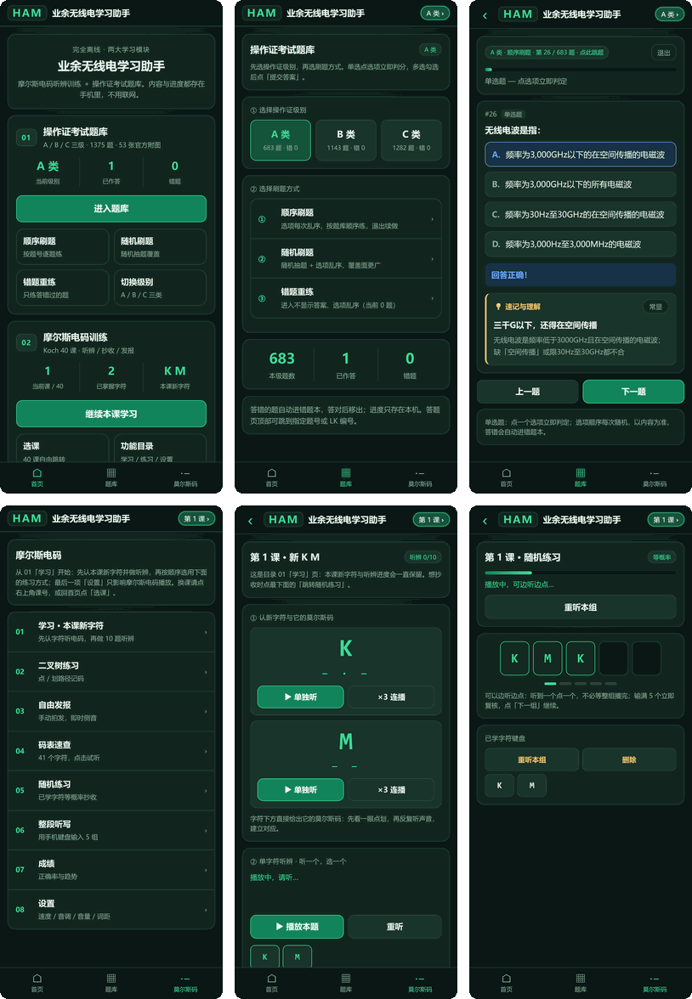
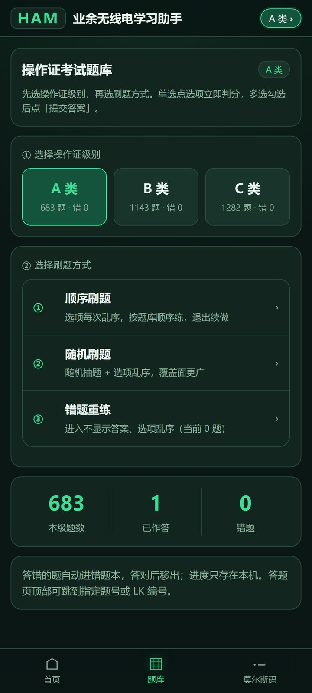
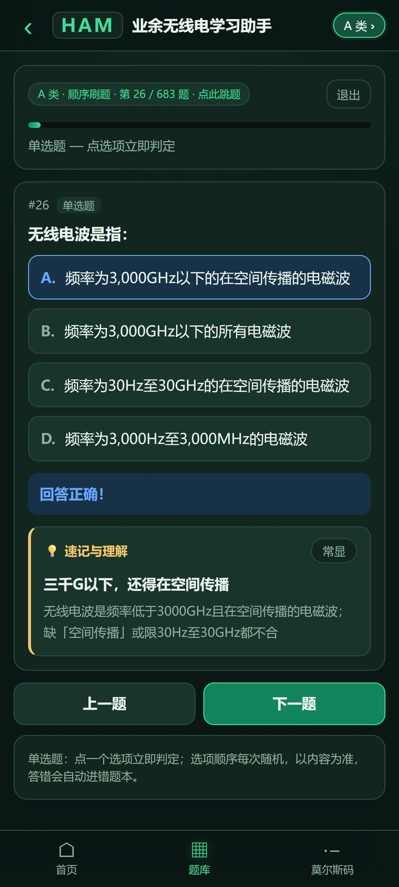
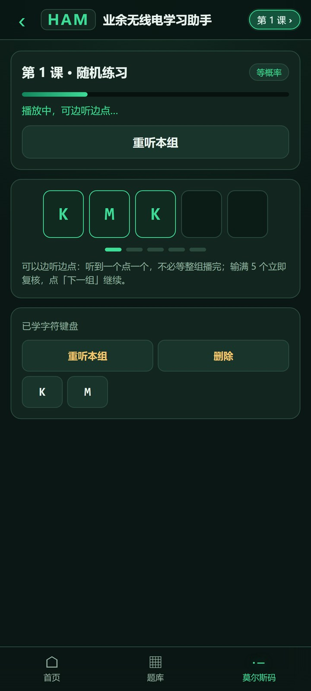
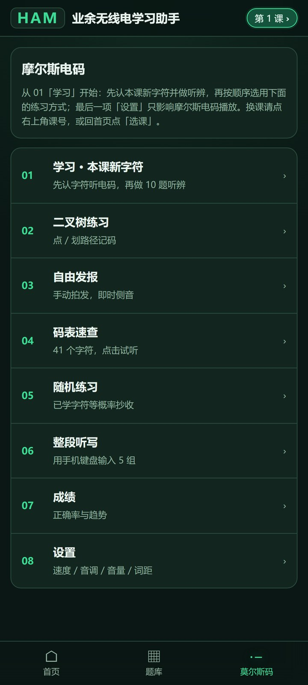
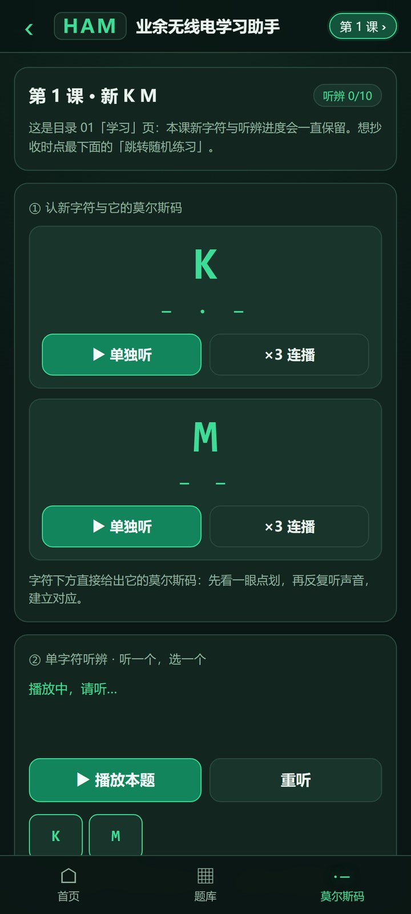
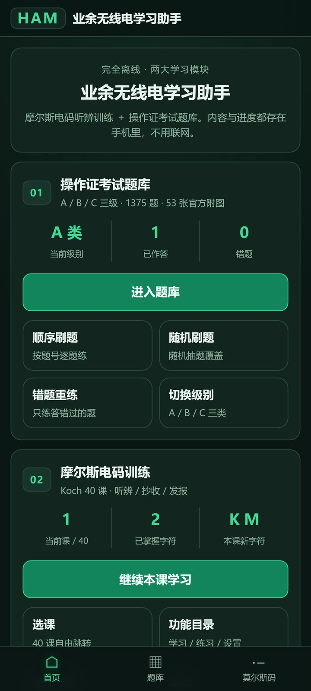

# 业余无线电学习助手

考取 A / B / C 类操作证书的题库刷题，加一套摩尔斯电码训练。1375 道题、53 张官方附图、40 课 Koch 训练，全部装在一个应用里，**完全离线运行**。

Android 6.0 及以上，安装包只有 640 KB。

  

## 下载

### [下载 ham-radio-cn-v1.1.1.apk](ham-radio-cn-v1.1.1.apk)

| 项目 | 内容 |
|---|---|
| 版本 | 1.1.1（versionCode 3） |
| 大小 | 640 KB |
| 系统要求 | Android 6.0（API 23）及以上 |
| 包名 | `cn.radiostudy.app` |
| 签名 | 正式签名，后续版本可直接覆盖升级 |
| 联网 | 运行时不需要网络，题库与音频全部内置 |

下载后如果浏览器提示「此类文件可能有害」，这是 Android 对所有非应用商店 APK 的统一提示，选择「仍要下载」即可。

## 安装

1. 手机上点上面的下载链接，把 APK 存到手机里。
2. 打开「文件管理」找到 `ham-radio-cn-v1.1.1.apk`，点击安装。
3. 首次安装时系统会问是否允许「安装未知应用」，给浏览器或文件管理器打开这个权限。
4. 如果弹出「已阻止安装」，在提示框里点「设置」→ 打开「允许安装未知应用」→ 返回继续安装。

装好后图标名是「业余无线电学习助手」，不需要联网，打开就能用。

## 功能

### 题库

- **A / B / C 三类**分开放，按操作证书等级对应
- **三种刷题方式**：顺序刷题、随机练习、只练错题
- 题干、选项、进度、正确率都在一屏，不用来回翻
- 选错时正确项标蓝、判定写出正解，并附官方原文出处
- 每道题配一句速记，讲清楚为什么选它
- 输入 LK 编号直接跳题，53 张官方附图随题放大显示
- 作答记录、错题本、当前进度分别保存

  
  
  

### 摩尔斯电码

- **Koch 顺序 40 课**，从 K、M 开始，按记忆规律循序渐进
- 每个字符可**单独收听**，点、划、间隔都按标准速度发出
- **听辨训练**：听一个答一个，答错会告诉你刚才是什么并自动重播，答对记连对
- **抄收练习**：整组一次播完，边听边敲，满 5 个立即逐位复核，对蓝错红
- 发报速度、音调、间隔都可以调
- 进度按课保存，随时接着上次的往下走

  
  
  

## 关于数据

题库内容整理自公开的业余无线电操作证书考试题库，仅供个人学习使用。题目的著作权归原权利人，本应用不主张任何权利。

应用不收集个人信息，不上传任何使用数据，不含广告和统计 SDK。

## 反馈

发现错题、答案有疑问，或者想要什么功能，直接开 [Issue](../../issues) 说一声，最好带上题目编号（LK 开头那串），方便定位。
